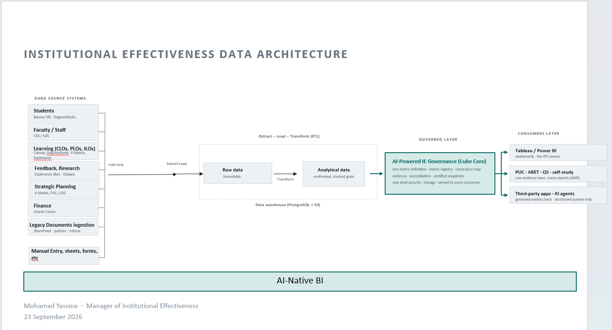

# Architecture

How AI-native BI works — system structure, data model, key patterns, and the design decisions behind them. This is a living document: update it when the architecture changes, and link architectural decisions to [DECISIONS.md](DECISIONS.md) for their rationale.

> **OKF conformance.** This document follows the [Open Knowledge Format v0.2](https://github.com/GoogleCloudPlatform/knowledge-catalog/blob/main/okf/SPEC.md) convention. Architectural decisions recorded here should link to their canonical record in DECISIONS.md.

---

## System overview

The BI is the institution's **AI-native business intelligence platform**: one institution, one deployment
([DEC-002](DECISIONS.md#DEC-002)). It takes data from the institution's source systems, keeps it in its own warehouse, defines every
KPI once in a governed metric layer, and serves those KPIs to every consumer. An **agent** builds most of it: the integrations, the
KPIs and the dashboards, each approved by a person before it goes live ([DEC-006](DECISIONS.md#DEC-006)).

It works **on its own** and **with the AMS** (drmoyassine/ams), the accreditation and quality management system, which is one
consumer among others (see "The AMS" below).

*Institutional Effectiveness Data Architecture, Mohamad Yassine, Manager of Institutional Effectiveness, 23 September 2026.*

| Layer | What | Built with |
|---|---|---|
| Sources | Students (Banner SIS, DegreeWorks), faculty and staff (FAS/SAS), learning outcomes (Canvas, DegreeWorks, X-Matrix, Explorance), feedback and research (Explorance Blue, DSpace), strategic planning (X-Matrix, FAS/SAS), finance (Oracle Fusion), documents (SharePoint, policies, criteria, AMS evidence files), and manual entry, sheets and forms | Read-only access; each source is one integration |
| Extract and load | Each integration copies a source as it is into **raw** storage: files in S3, immutable, loaded into the `raw` schema | dlt pipelines, one standard pattern the agent fills in |
| Transform | `raw` into **analytical** data in the `analytics` schema: conformed across sources, at student grain | dbt models ([DEC-010](DECISIONS.md#DEC-010)) |
| Governed layer | Each KPI defined **once** in the metric registry, with its steward, version and lineage; row-level security; certified snapshots (a report or dataset saved as it was at a point in time) | Cube (Cube Core, open source) |
| Serving | One general-purpose API and an MCP server on top of Cube ([DEC-009](DECISIONS.md#DEC-009)) | FastAPI; MCP |
| Consumers | The BI's own dashboards (the KPI canvas, generative UI), the AMS, Tableau and Power BI (Cube's SQL API), third-party apps and AI agents | |

The back end is Python ([DEC-003](DECISIONS.md#DEC-003)): FastAPI, Pydantic, Procrastinate, dlt, pytest. The UI is TypeScript/React;
Cube is its own Node service. Today the code is the AMS adapter, in Python since [ROADMAP-001](ROADMAP.md#ROADMAP-001).

## Data model

- **Warehouse** ([DEC-005](DECISIONS.md#DEC-005)): PostgreSQL, the BI's own database also when it shares a server with the AMS
  (AMS DEC-017 and AMS DEC-034):
  - **files**, kept unchanged under their SHA-256 (`RAW_FILES_URL`: a volume today, a bucket such as Garage later), read-only;
  - **`raw`** (`src/bi/ingest.py`, dlt): one table per dataset, every cell as text exactly as written, every row with its file
    (`_bi_file_sha256`, `_bi_file_name`, `_bi_row`), its as-of date and load time. Appended, never changed;
  - **`staging`** (dbt views, `src/bi/transform`): typed, and the current snapshot: for each term, the latest upload replaces the
    earlier ones;
  - **`analytics`** (dbt tables): conformed, at student grain (`analytics.enrollment`: one row per student and term), with dbt tests.
- **Metric registry**: the Cube model (`cube/model`); one definition per KPI, with steward, version and lineage. The worker's source
  maps the AMS's metric names onto it (`src/bi/metrics.py`).
- **AMS requests**: `collect_request` (migration `0001`; the job queue is Procrastinate's schema, migration `0002`), one row per AMS
  run and attempt, holding the request and its outcome (`queued`, `running`, `supplied`, `no_source`, `no_data`, `refused`, `failed`).
  The callback token is cleared when the request ends.

## Key patterns

- **Every read of a KPI goes through Cube** ([DEC-004](DECISIONS.md#DEC-004)). The canvas, the AMS adapter, the API, the MCP server
  and Tableau or Power BI read the governed layer, never the `raw` or `analytics` tables.
- **Structured queries only.** Consumers, including AI agents and the AMS, ask in Cube's terms (measures, dimensions, filters,
  time); nobody sends SQL.
- **Extract and load, then transform.** Raw data is immutable and replayable; transforms can be rebuilt from it.
- **The agent fills in standard patterns.** Integrations follow one dlt pattern and KPIs one Cube pattern, proven by hand first
  ([ROADMAP-002](ROADMAP.md#ROADMAP-002)) and then copied by the agent ([ROADMAP-003](ROADMAP.md#ROADMAP-003)).
- **No invented data.** A KPI with no data has no answer. Every answer carries `asOf` and `lineage`.

### The agent

The agent is how people use the BI. In a chat, a user asks it to:

- **Connect a source.** It asks what it needs (the system, credentials, which tables or exports), writes the integration from the
  standard pattern, tests it on real data, sets the privileges and runs the first load into the warehouse.
- **Define a KPI.** It writes the transform and the Cube definition, shows the result and its lineage, and waits for approval.
- **Build a dashboard.** Generative UI: it composes the dashboard from governed KPIs; the user then configures it.

Built so far (step 2a, [TASK-012](TASKS.md#TASK-012); the full design is `docs/agent-spec.md`): **asking**. A person asks in the chat
and the agent answers from the governed metrics with tables and proposed charts; it cannot yet build anything. The loop (Pydantic
AI, [DEC-015](DECISIONS.md#DEC-015)) runs in a worker job, never in the API; the API stores the message, queues the turn and streams
the turn's events to the browser over SSE from PostgreSQL ([DEC-018](DECISIONS.md#DEC-018)). The model is one of five provider
kinds an admin configures in the app, with its model list fetched from the provider ([DEC-016](DECISIONS.md#DEC-016)); keys are
kept encrypted in the BI's own database ([DEC-020](DECISIONS.md#DEC-020)). The model never sees rows: its tools return schemas,
profiles and aggregates with small counts hidden ([DEC-017](DECISIONS.md#DEC-017)), and a chart it proposes is drawn from the same
hidden-small-counts read (`/app/api/drafts/<id>/data`), so the chat shows nothing the model was not allowed to see.

### The app

The web app (`web/`, [DEC-014](DECISIONS.md#DEC-014)) is a React single-page app built into the API image and served at `/`; its
API is `/app/api`. People sign in with the BI's own accounts (single sign-on later, [ROADMAP-005](ROADMAP.md#ROADMAP-005)); a
session is an HttpOnly, SameSite=Strict cookie, and every write also carries `X-BI-App: 1`. An upload is kept under
`incoming/`, then the worker's `load` job loads it and rebuilds analytics, and the app shows its status, rows and dbt tests. The
chart page builds a chart definition from Cube's governed members and draws its rows ([ROADMAP-009](ROADMAP.md#ROADMAP-009)). The
chat (Ask) and, for admins, the Models page (providers, keys, which models people may use) belong to the agent above.

### Charts and dashboards

Every chart is one **chart definition** of the BI's own JSON schema ([DEC-012](DECISIONS.md#DEC-012)): a Cube query (measures,
dimensions, filters, time), the visual (type; which field goes on x, y, colour, size) and its labels. Three ways build it, one object
results:

- **the agent**, in the app's chat;
- **the API**, for apps and agents outside the BI;
- **drag and drop**, Looker-style: the field panel is Cube's metadata (governed measures and dimensions only), fields are dragged into
  slots, and the chart re-queries live.

One translator turns a definition into Apache ECharts options: rendered in the browser in the app, and as PNG or SVG by a small
server-side renderer for consumers, who get either the definition with its data or the image. Neither the agent nor the API writes
raw ECharts options. A chart or dashboard is a private draft until approved for publishing; only published ones are shared or served
by the API ([DEC-013](DECISIONS.md#DEC-013)).

### The AMS

The AMS **requests**; the BI **owns its KPIs end to end** ([DEC-007](DECISIONS.md#DEC-007)). The AMS may ask for a reading of a
KPI, a table, a dashboard, or a new KPI (by a request schema), and the BI answers in the format asked. Manual entry, sheets and forms
belong to the BI.

Today the contract (`docs/ams-bi-contract-v0.md`, owned by the AMS; routes in `docs/endpoints.md`) covers one kind of request:
collect one run (`POST /ams/collect`, answered 202 and then by the callback). The other kinds need the AMS to change the contract
first: see `docs/ams-contract-proposals.md` ([TASK-006](TASKS.md#TASK-006)).

## Cross-cutting concerns

- **Approval** ([DEC-006](DECISIONS.md#DEC-006)): an integration, a KPI or a dashboard built by the agent is live only after a
  person approves it, including a KPI the AMS asks for.
- **Agent containment:** the agent's code runs in a sandbox; credentials go to a secret store, never into code, the repository or
  logs; access to sources is read-only.
- **Privacy:** nothing student-level leaves the BI; consumers get aggregates with small cells suppressed. The rules (regulator,
  threshold, how a suppressed cell is marked) are open: [TASK-002](TASKS.md#TASK-002), before the first real upload. Real exports
  arrive through the frontend and are never committed to the repository ([DEC-011](DECISIONS.md#DEC-011)).
- **Security:** row-level security in Cube; Cube's own database role reads `analytics` only, never `raw` or `staging`
  ([TASK-007](TASKS.md#TASK-007)). The AMS calls with `BI_API_KEY`; the BI calls back only the run's own supply route on
  `AMS_CALLBACK_ORIGIN`, never follows a redirect, and forgets the token when the request ends.
- **Authentication:** the BI's own accounts (Argon2id, server-side sessions, [DEC-014](DECISIONS.md#DEC-014)); the institution's
  single sign-on later ([ROADMAP-005](ROADMAP.md#ROADMAP-005)). Sign-in throttling is still to do ([TASK-010](TASKS.md#TASK-010)).
- **Observability:** structured JSON logs.
- **Deployment:** Docker Compose, alone (`compose.yaml`) or beside the AMS (`compose.together.yaml`). A later self-serve free trial
  is its own small deployment on a real PostgreSQL ([ROADMAP-007](ROADMAP.md#ROADMAP-007)).

## Architectural decisions

- **One institution per deployment** — see [DEC-002](DECISIONS.md#DEC-002)
- **Python stack (FastAPI)** — see [DEC-003](DECISIONS.md#DEC-003)
- **Cube is the governed layer and the only read path for KPIs** — see [DEC-004](DECISIONS.md#DEC-004)
- **Warehouse: raw and analytics on PostgreSQL, raw files on S3** — see [DEC-005](DECISIONS.md#DEC-005)
- **A person approves what the agent builds** — see [DEC-006](DECISIONS.md#DEC-006)
- **The AMS requests; the BI owns its KPIs end to end** — see [DEC-007](DECISIONS.md#DEC-007)
- **Phase 1 on test files; real data through the frontend** — see [DEC-011](DECISIONS.md#DEC-011) (supersedes DEC-008)
- **dbt for transforms** — see [DEC-010](DECISIONS.md#DEC-010)
- **One general-purpose API and MCP server on Cube** — see [DEC-009](DECISIONS.md#DEC-009)
- **One chart definition, rendered with ECharts** — see [DEC-012](DECISIONS.md#DEC-012)
- **Charts and dashboards: private drafts, approved to publish** — see [DEC-013](DECISIONS.md#DEC-013)
- **The app: own accounts, a cookie session, a React app served by the API** — see [DEC-014](DECISIONS.md#DEC-014)

The phases are roadmap items: [ROADMAP.md](ROADMAP.md).

## How to update this document

- When you add a new component or service, document it in **System overview**.
- When you make an architectural decision, record it in DECISIONS.md (`/decisions add`) and link it from the relevant section above.
- When you change the data model, update **Data model**.
- Run `vef setup` after direct canonical edits and `vef check` as the strict local/CI acceptance gate.
- Use `vef show`, `vef refs`, `vef why`, `vef graph`, and `vef search` to inspect canonical project state without an agent.
